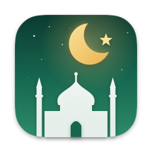
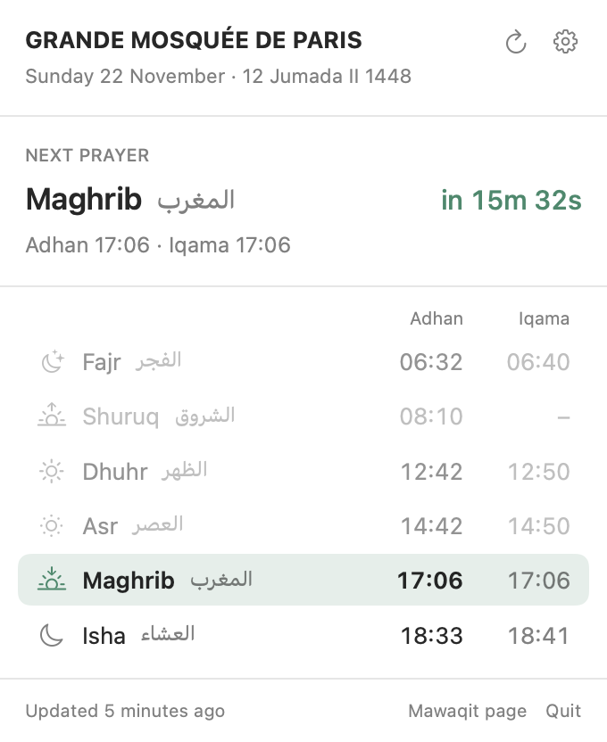
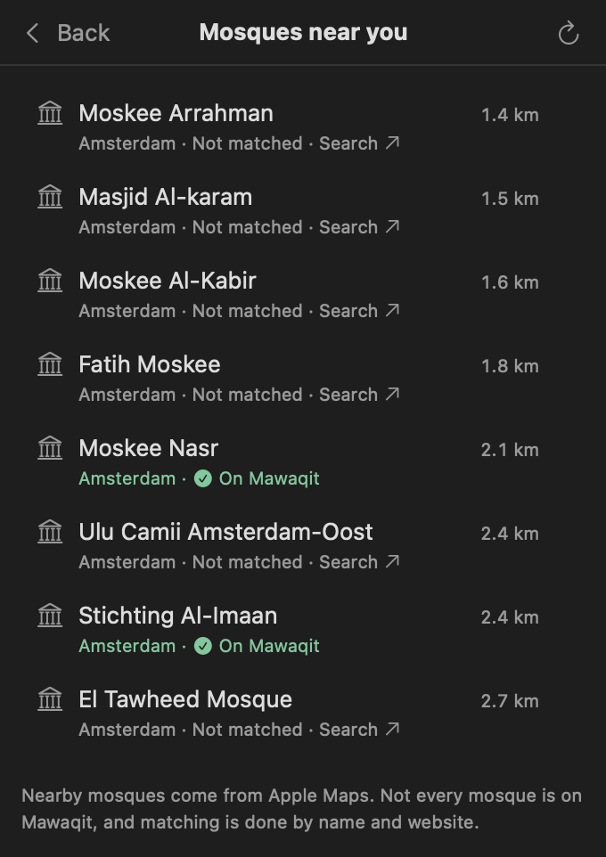
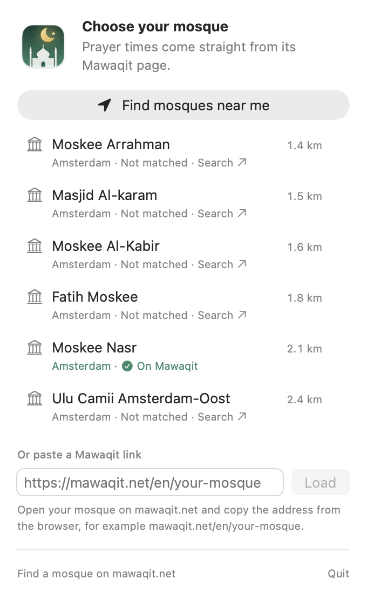

<p align="center"></p>

<h1 align="center">Mawaqit Prayer Time for Mac</h1>

<p align="center">
  Your mosque's prayer times from <a href="https://mawaqit.net">Mawaqit</a>, right in the macOS menu bar.<br>
  <a href="https://github.com/taybX/mawaqitPrayerTime-Mac/releases/latest"><b>Download the latest version</b></a>
  · macOS 14 Sonoma or later · Apple Silicon and Intel
</p>

> **Unofficial.** This app is not made by or affiliated with Mawaqit. It shows the prayer times
> that mosques publish on their public Mawaqit pages.

<p align="center">
  
  
</p>

## Features

- **Next prayer in the menu bar:** a countdown ("Maghrib in 19m"), the prayer time, or just an icon.
- **Today's timetable:** Fajr, Shuruq, Dhuhr, Asr, Maghrib and Isha with adhan and iqama times,
  Jumu'a times on Fridays, the Gregorian and Hijri date, and a live countdown.
- **Find mosques near me:** lists mosques around you and marks the ones on Mawaqit, so you can pick
  yours with one click. Or paste any Mawaqit mosque link.
- **Notifications** at the prayers you choose, plus an optional reminder 5–30 minutes before.
- **Works offline:** one download holds your mosque's whole year and refreshes every 12 hours.
- Open at login, 12- or 24-hour clock, light and dark mode. No Dock icon, no window to manage.

## Install

1. Download **MawaqitPrayerTime-1.0.zip** from the
   [latest release](https://github.com/taybX/mawaqitPrayerTime-Mac/releases/latest).
2. Double-click the zip to unpack it, then drag **MawaqitPrayerTime.app** into your **Applications** folder.
3. Open the app. The first time, macOS blocks it, because it isn't notarized by Apple
   (that needs a paid Apple developer account). To allow it:
   - **macOS 15 Sequoia and later:** click **Done** on the warning, open
     **System Settings › Privacy & Security**, scroll down to the message about MawaqitPrayerTime
     and click **Open Anyway**. Confirm with your password or Touch ID.
   - **macOS 14 Sonoma:** right-click the app in Applications, choose **Open**, then **Open** again.
   - Or, in Terminal: `xattr -dr com.apple.quarantine /Applications/MawaqitPrayerTime.app`
4. A crescent appears in the menu bar at the top right of your screen. There is no window or Dock icon.
   Click the crescent to choose your mosque.

To start it automatically, click the crescent, then the gear, and turn on **Open at login**.

> Don't see the crescent? Your menu bar may be full, which hides icons behind the notch on MacBooks.
> Quit another menu bar app and it appears.

**Updating:** quit the app (crescent › **Quit**), replace it in Applications with the new version
and open it again. Your mosque and settings are kept.

**Uninstalling:** quit the app and delete it from Applications. To remove its settings and saved
timetable too, delete the folder `~/Library/Containers/com.mkotesh.MawaqitPrayerTime`.

## Using it



**Choosing your mosque.** Click **Find mosques near me** and allow location access. You get the
mosques within 15 km, nearest first:

- **✓ On Mawaqit:** click it, and you're done.
- **Not matched · Search ↗:** opens a web search on mawaqit.net for that mosque. Copy its Mawaqit
  link from the results and paste it into the field.

You can also paste a link straight away: find your mosque on [mawaqit.net](https://mawaqit.net)
and copy the address from your browser, for example `https://mawaqit.net/en/your-mosque`.

**Every day.** The menu bar shows the next prayer. Click it for today's timetable; the next prayer
is highlighted. The ↻ button reloads the times, and the gear opens the settings: change mosque,
menu bar style, clock format, notifications and Open at login.

<br clear="right">

## Privacy

- No account, no tracking, no analytics. Settings and the downloaded timetable stay on your Mac.
- The app only connects to:
  - **mawaqit.net**, to download your mosque's public page (when you choose it, then every 12 hours);
  - **Apple Maps**, only when you use *Find mosques near me*. Your location is sent to Apple to search
    around you. It is used for that search only and not stored;
  - **the websites of nearby mosques**, during that search, to look for their Mawaqit link.
- Clicking **Search ↗** opens a Google search in your browser.

## How it works

Mawaqit's API is private, so the app doesn't use it. Every public mosque page on mawaqit.net already
contains the mosque's full timetable (a yearly calendar, iqama times, Jumu'a times, time zone and
Hijri adjustment) for the page's own JavaScript. The app downloads that page, reads that data and
saves it in its sandbox. If Mawaqit changes its page format, `MosquePageParser.swift` is the one
place to fix.

**Nearby mosques** come from Apple Maps. For each one, `MawaqitPageFinder` looks for its Mawaqit
page: a Mawaqit link listed as the mosque's website, Mawaqit links or widgets on its own website,
then page addresses guessed from its name. A page only counts if its location is within 2 km of the
mosque, so a common name can't match a mosque in another city. In tests around Amsterdam and Paris
it matched roughly 1 in 5 mosques; many simply aren't on Mawaqit.

## Build from source

You need **Xcode 26 or later**.

- Open `MawaqitPrayerTime.xcodeproj` and press **⌘R**, or use the scripts in `Tools/`:

  | Command | What it does |
  | --- | --- |
  | `Tools/build.sh` | Builds a Release copy and prints where it is (`Tools/build.sh Debug` for a debug build). |
  | `Tools/install.sh` | Builds a Release copy, puts it in /Applications (replacing the old one) and starts it. |
  | `Tools/test.sh` | Runs the unit tests. |

- Builds are signed to run locally. To sign with your own certificate, pick your team under
  **Signing & Capabilities** and change the bundle identifier.
- The scripts build into `~/Library`, never into the project folder, so a project kept in
  iCloud Drive doesn't upload build files.
- The app icon is drawn in code: edit `Tools/make-app-icon.swift` and run the command at its top.

### Project layout

```
MawaqitPrayerTime/            The app (SwiftUI MenuBarExtra, macOS 14+, Swift 6)
  AppModel.swift              State, settings, clock, refresh, notification scheduling
  MosqueStore.swift           Saved copy of the last download
  PrayerNotifier.swift        Notifications
  Nearby/                     Location and the Apple Maps search
  Views/                      Menu bar label, panel, timetable, setup, settings, nearby list
Packages/MawaqitKit/          All the logic, as a plain Swift package with unit tests
  MawaqitClient.swift         Mosque links and page download
  MosquePageParser.swift      Reads the timetable out of a mosque page
  MosqueData.swift            The timetable data
  PrayerSchedule.swift        Today's times, next prayer, iqama, Jumu'a, Hijri date
  MawaqitPageFinder.swift     Finds the Mawaqit page of a mosque found on Apple Maps
Tools/                        Build, install and test scripts, and the icon generator
```

The tests cover page parsing, link handling, iqama delays and fixed times, Isha after midnight,
Fridays, the Hijri adjustment and nearby matching, all with made-up data.

## Limitations

- Unofficial: it depends on the format of Mawaqit's public pages, which could change.
- Nearby search finds every mosque on Apple Maps but can only match some of them to Mawaqit.
- Times are shown in the mosque's time zone, as Mawaqit publishes them.
- Not notarized, so macOS asks you to allow it once (see [Install](#install)).

## Contributing

Bug reports and pull requests are welcome. Please run `Tools/test.sh` before sending a change.

## License

[MIT](LICENSE)
